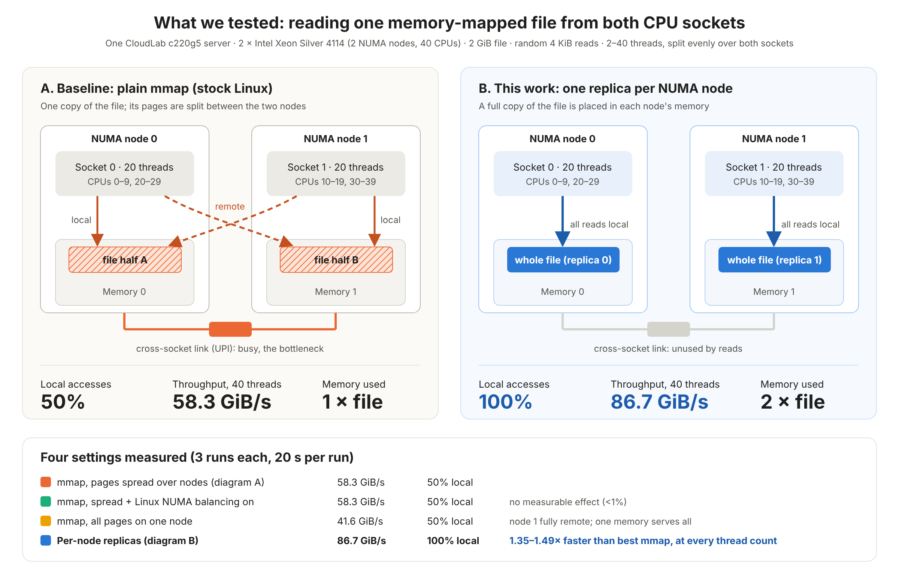
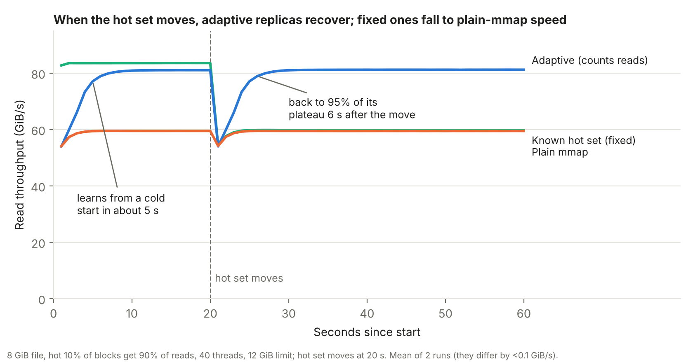

# Per-node replication of memory-mapped files on NUMA

An OS course project extending **PaCaR** ("PaCaR: Improved Buffered I/O Locality on NUMA Systems with Page Cache Replication", EuroSys '26). PaCaR keeps one copy of page-cache pages per NUMA node, but only for `read()`/`write()`. It lists two limitations: no support for memory-mapped (mmap) files, and replicas shrinking the page cache when memory is short. This project measures both on a real two-socket server and tests a user-space version of per-node replication for mapped files.





## Results (19 Nov 2026, CloudLab `c220g5`, 2 × Xeon Silver 4114)

| Experiment | Question | Result |
|---|---|---|
| Run 1 | Do per-node replicas of a mapped file help? | Yes: 1.35–1.49x faster than the best plain-mmap setting; local accesses 50% → 100% |
| 1. NUMA balancing counters | Why does Linux NUMA balancing not help? | It skips read-only file mappings entirely; when the file is mapped writable it moves more pages than the file has, with no locality gain. The control proves balancing works for single-socket data |
| 2. 8 GiB file | Does the gain depend on file size? | No: 1.36–1.54x with a four times larger file |
| 3. Unpinned threads | Does it survive when the scheduler places threads? | Yes: 1.40–1.49x, within 2% of pinned threads |
| 4. Writes (main/twin rule) | How much survives once writes keep copies consistent? | Gain while writes are rare (1.46x at 99% reads), break-even at 87–90% reads, slower below; a write caught by a page fault costs 6.5–19.6 µs |
| 5. Limited memory (limitation 2) | Does full replication fail when memory is short, and does replicating only hot data fix it? | Yes to both: full replicas fell to 8–17x slower than plain mmap once they no longer fitted (12 and 10 GiB limits), while replicating only the hot 10% kept 1.40x at every limit with a fifth of the extra memory |
| 6. Automatic hot-page detection | Can the hot pages be found by counting reads, and does it follow the hot set when it moves? | Yes: 97% of the known-hot-set speed (1.36x over plain mmap) with no advance knowledge; learns in about 5 s; when the hot set moved, it recovered in 6 s while the fixed choice fell to plain-mmap speed. Tuning: a threshold of 3 is best; a larger area does not help; the remaining 3% gap is the cost of the replica lookup |

Full details, tables and charts: [`docs/experiment-plan.md`](docs/experiment-plan.md). Day-by-day notes: [`docs/project-log.md`](docs/project-log.md).

## Repository layout

| Folder | Contents |
|---|---|
| [`code/`](code) | The benchmark (`numa_mmap_bench.c`), the fault-cost tool (`fault_cost.c`), one run script per experiment, `summarize.py` and `plot_results.py`. See [`code/README.md`](code/README.md) |
| [`results/`](results) | Raw CSV output of every experiment, one folder each, plus the machine's configuration (`results/system/sysinfo.txt`) |
| [`figures/`](figures) | Charts and the method diagram |
| [`docs/`](docs) | The experiment plan with all results, and the project log |

## Reproducing on CloudLab

Step-by-step instructions, including how the machine was allocated, are in the appendix of [`docs/experiment-plan.md`](docs/experiment-plan.md). In short:

1. Join the CloudLab project `numammapresearch` and add your SSH public key.
2. Start an experiment: profile `small-lan`, 1 node, Ubuntu 24.04, hardware type `c220g5`.
3. Copy the `code/` folder to the machine, then:

```
sudo apt update && sudo apt install -y build-essential numactl python3-matplotlib unzip tmux
lscpu | grep NUMA                     # must show 2 NUMA nodes
cd code && make
tmux
sudo ./run_experiment.sh              # run 1 (add SIZE_MB=8192 FILE=./data8g.bin for experiment 2)
sudo FILE=./data.bin ./run_exp1.sh    # experiment 1
sudo FILE=./data.bin ./run_exp3.sh    # experiment 3
sudo FILE=./data.bin ./run_exp4.sh    # experiment 4 (modifies data.bin)
sudo FILE=./data8g.bin ./run_exp5.sh check && sudo FILE=./data8g.bin ./run_exp5.sh   # experiment 5
sudo FILE=./data8g.bin REP=./rep_hot10_ ./run_exp6.sh          # experiment 6 (uses experiment 5's replica files)
python3 summarize.py <results file>
```

`run_experiment.sh` creates `data.bin` (2 GiB) or the 8 GiB file on first use. Data and replica files (`*.bin`) are never committed.

## Team notes

- The machine is erased when the CloudLab experiment ends: copy results off before it expires.
- Commands are run from a laptop terminal: `scp` on the laptop, everything else on the server (prompt `Arefin@node0` or your own username).
