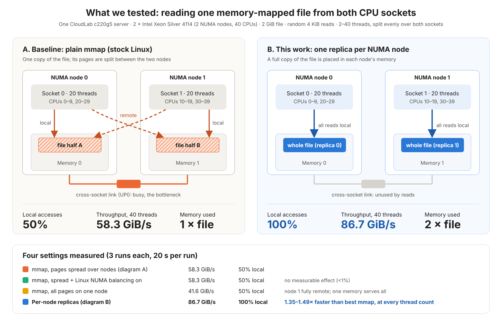
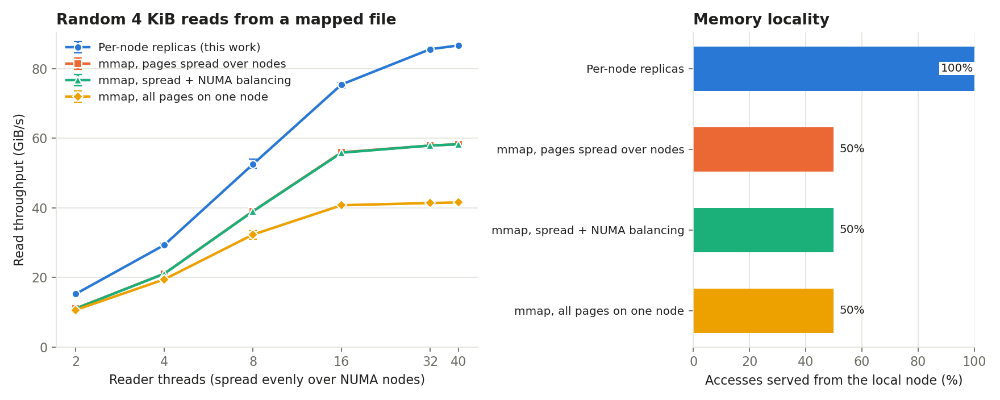
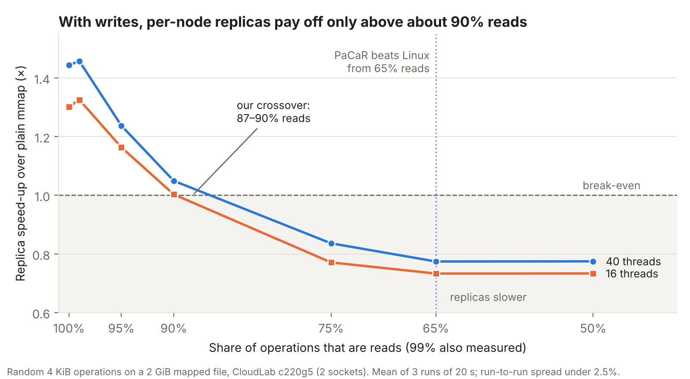

# Experiment Plan and Results: mmap Replication on NUMA

Last updated 19 Nov 2026 · Muhammed Nazmul Arefin

> Exported from the team's working document. Figures are in [`../figures`](../figures), raw results in [`../results`](../results).

## Purpose

Four follow-up experiments, all on the same CloudLab `c220g5` machine as run 1, turn one positive result into a tested argument about PaCaR's mmap limitation. Run 1 showed that per-node replicas of a mapped file are 1.35–1.49x faster than stock Linux. The follow-ups ask why NUMA balancing fails (experiment 1), whether the gain holds for a larger file (2), whether it survives when threads move between sockets (3), and what it costs once writes are allowed (4).

Experiments 1 and 2 need no new code and start immediately. Experiments 3 and 4 need new benchmark modes, written while experiment 2 runs.

## What PaCaR claims and where this project fits

This project targets PaCaR's first limitation and the reassurance the paper attaches to it. The second limitation is touched only by experiment 2's memory cost.

| PaCaR statement | Where in the paper | Targeted here |
| --- | --- | --- |
| Replicating shared, read-mostly page-cache data per node improves throughput (up to 1.4–1.6x on read-only workloads) | Evaluation | Yes: all experiments compare against this range |
| Limitation 1: mapped (mmap) pages are not replicated, because their accesses bypass the kernel; PaCaR skips any page with mapcount > 0 | Sections 5.1 and 7 | Yes: the core of the project |
| Linux NUMA balancing "already targets mmaped pages", so mapped files are more NUMA-aware | Section 7 | Yes: experiments 1 and 3 |
| Proposed mmap design: per-node page tables pointing to local replicas, write-protected so writes fault and the kernel keeps copies consistent | Section 7 | Partly: experiment 4 measures the cost of keeping copies consistent |
| Writes are applied to the main copy and twins are invalidated; below about 65% reads PaCaR is slightly slower than Linux | Sections 4.3 and 6 | Yes: experiment 4 looks for the same crossover |
| Limitation 2: replicas shrink the effective page-cache size; large datasets may hit disk more | Section 7 | Only indirectly: experiment 2 reports memory used |

## What run 1 established

Run 1 showed a consistent 1.35–1.49x gain from per-node replicas, with local accesses rising from 50% to 100%. Machine: CloudLab `c220g5`, two Xeon Silver 4114 sockets (2 NUMA nodes, 40 logical CPUs), Ubuntu 24.04, kernel 6.8. Workload: a 2 GiB file, random 4 KiB reads, 2–40 pinned threads split evenly over both sockets, 3 repetitions of 20 s for each of 4 settings. At 40 threads, plain mmap levelled off at 58.3 GiB/s and replicas reached 86.7 GiB/s. Turning NUMA balancing on changed throughput by under 1%.



Panel A: with plain mmap, each socket reads half its data across the link between sockets, which becomes the bottleneck. Panel B: with one replica per socket, every read stays local, at the cost of twice the memory.



Left: per-node replicas (blue) pull ahead of all three plain-mmap settings at every thread count; the two spread settings, with and without NUMA balancing, overlap. Right: the replicas serve 100% of reads locally, every mmap setting 50%.

It leaves four questions open:

1. Why did NUMA balancing do nothing: did it try and fail, or never look at these pages?
2. Is the gain specific to a 2 GiB file?
3. Does it hold when threads are not pinned, which is the setting that gives NUMA balancing its best chance?
4. What happens once writes force the replicas to be kept consistent?

## Resource configuration

Every experiment ran on the same physical server: one CloudLab `c220g5` node with two Intel Xeon Silver 4114 sockets, 192 GB of DDR4 memory and Ubuntu 24.04 on Linux 6.8. The values below were read from the machine itself on 19 Nov 2026 (`lscpu`, `numactl --hardware`, `free`, `dmidecode`, `lsblk`); how the machine was obtained is in the appendix.

### Processor

| Item | Value |
| --- | --- |
| CPU model | Intel Xeon Silver 4114 @ 2.20 GHz (Skylake-SP, family 6, model 85, stepping 4) |
| Sockets × cores × threads | 2 × 10 × 2 = 40 logical CPUs |
| Clock range | 800–3000 MHz |
| L1 data / L1 instruction cache | 32 KiB each per core (640 KiB each in total) |
| L2 cache | 1 MiB per core (20 MiB in total) |
| L3 cache | 13.75 MiB per socket, shared by its cores (27.5 MiB in total) |
| Vector extensions | AVX2 and AVX-512 |

### NUMA layout and memory

| Item | NUMA node 0 | NUMA node 1 |
| --- | --- | --- |
| Logical CPUs | 0–9, 20–29 | 10–19, 30–39 |
| Memory | 95,303 MB | 96,757 MB |
| Free at the time of the snapshot | 89,495 MB | 91,011 MB |
| Distance to node 0 / node 1 | 10 / 21 | 21 / 10 |

A distance of 21 against 10 is the kernel's estimate that reaching the other socket's memory costs about twice as much as local memory. The memory is 6 DDR4 modules of 32 GB, rated 2666 MT/s but configured at 2400 MT/s, with single-bit ECC; 18 of the 24 slots are empty. If the six modules sit one per memory channel, each socket uses 3 of its 6 channels, about 57.6 GB/s of peak bandwidth per socket. That fits the measurements: plain mmap with all pages on one socket levelled off at about 42 GiB/s, and replicas using both sockets reached about 87 GiB/s. The channel layout is an inference; `dmidecode` was not asked for slot locations. The system also has 7 GB of swap, which experiment 5 disables for its runs.

### Storage

| Device | Model | Size | Use |
| --- | --- | --- | --- |
| `sda` | Intel SSD SSDSC2BB48 (SATA SSD, SAS controller) | 447 GB | Root file system `/dev/sda3`, 63 GB; holds every data and replica file |
| `sdb` | Seagate ST1200MM0088 (hard disk) | 1.1 TB | Not used |

At the time of the snapshot the root file system was 59% full (35 GB used, 25 GB free), mostly from the data files of runs 1–2 and the 22 GB of replica files for experiment 5. Disk speed matters only in experiment 5, where evicted pages are read back from this SSD.

### Software and kernel settings

| Item | Value |
| --- | --- |
| Operating system | Ubuntu 24.04.5 LTS |
| Kernel | 6.8.0-149-generic, stock Ubuntu kernel (PaCaR's patched kernel was not used) |
| Compiler | gcc 13.3.0, flags `-O2 -Wall -Wextra -pthread` |
| Python | 3.12.3 with matplotlib, for plots only |
| Page size | 4 KiB; every data mapping and replica uses 4 KiB pages |
| Transparent huge pages | `madvise` mode; the benchmark opts its replicas out (`MADV_NOHUGEPAGE`) |
| NUMA balancing | Switched per run by the scripts (`/proc/sys/kernel/numa_balancing`) and restored afterwards |
| Security mitigations | Kernel page-table isolation (Meltdown), IBRS and others active. They add cost to every system call and page fault, so they raise the fault costs measured in experiment 4 |
| Memory limits (experiment 5) | cgroup v2 through `systemd-run --scope -p MemoryMax=… -p MemorySwapMax=0` |

### Benchmark parameters per experiment

| Experiment | File | Access | Threads | Settings compared | Repetitions × duration |
| --- | --- | --- | --- | --- | --- |
| Run 1 | 2 GiB | Random 4 KiB reads, uniform | 2, 4, 8, 16, 32, 40, pinned | mmap spread, spread + balancing, one node; replicas | 3 × 20 s |
| 1. Balancing counters | 2 GiB | As run 1 | 40 (1c: 20 on node 1) | Read-only map, read-write map, anonymous control | 1 × 60 s |
| 2. Larger file | 8 GiB | As run 1 | As run 1 | As run 1 | 3 × 20 s |
| 3. Unpinned threads | 2 GiB | As run 1 | 8, 20, 40 | mmap unpinned (balancing off, on); replicas unpinned, pinned | 3 × 20 s |
| 4. Writes | 2 GiB | Random 4 KiB reads and writes, 100–50% reads | 16, 40, pinned | mmap; replicas with main/twin rule; fault cost | 3 × 20 s |
| 5. Limited memory | 8 GiB | Random 4 KiB reads; 10% of blocks get 90% | 40, pinned | mmap; full, hot 10%, hot 25% replicas; limits 24–10 GiB | 2 × 30 s after 10 s warm-up |

All files hold random data. Unless a run says otherwise, the page cache is emptied before the first run of each setting, threads are split evenly over the two sockets, and file pages are spread over both nodes in 2 MiB chunks.

## Experiment 1: why NUMA balancing did nothing

This experiment uses the kernel's own counters to show whether NUMA balancing ever examined the mapped file's pages. It turns run 1's "under 1% difference" from an observation into an explanation.

**Question.** Did Linux NUMA balancing scan the mapped pages and fail to improve placement, or did it skip them altogether?

**Hypotheses.** H1a: balancing skips read-only file-backed mappings, so its counters stay near zero during the benchmark. The scheduler code that drives balancing appears to exclude such mappings on purpose; this experiment checks that claim rather than assuming it. H1b: if the same file is mapped writable, balancing does scan it, but locality still stays near 50%, because both sockets read every page and a single copy cannot be local to both.

**Method.** Three short runs at 40 threads, 60 s each, with balancing on, recording the change in four `/proc/vmstat` counters across each run:

| Run | Mapping | Purpose |
| --- | --- | --- |
| 1a | Read-only shared mapping, as in run 1 | Tests H1a |
| 1b | Same file mapped read-write, never written | Tests H1b; needs a small `-W` option in the benchmark |
| 1c | `stress-ng --vm 8 --vm-bytes 4G`, anonymous memory | Positive control: proves balancing is active on this machine |

Commands for run 1a (1b adds `-W`; 1c replaces the benchmark line with `stress-ng --vm 8 --vm-bytes 4G -t 60`):

```
echo 1 | sudo tee /proc/sys/kernel/numa_balancing
grep -E '^numa_(pte_updates|hint_faults|hint_faults_local|pages_migrated) ' /proc/vmstat > before.txt
./numa_mmap_bench -f data.bin -m shared -t 40 -d 60
grep -E '^numa_(pte_updates|hint_faults|hint_faults_local|pages_migrated) ' /proc/vmstat > after.txt
paste before.txt after.txt | awk '{print $1, $4 - $2}'
```

**Metrics.** Change in `numa_pte_updates` (pages balancing marked for inspection), `numa_hint_faults` and `numa_hint_faults_local` (accesses it sampled, and how many were local), `numa_pages_migrated` (pages it moved). Throughput and local share from the benchmark output.

**Success criteria.** 1c shows large non-zero counters, confirming the mechanism works. Then either 1a shows near-zero counters (H1a holds), or 1b shows activity with no locality gain (H1b holds). Either outcome explains run 1.

**Time.** About 10 minutes on the machine, plus installing `stress-ng`.

### Result of 1a (19 Nov, 15:30)

NUMA balancing barely touched the read-only mapped file. Over 60 s with balancing on, it marked 452 pages machine-wide, against 524,288 pages in the file (0.09%), although a single scan normally covers up to 65,536 pages. Throughput and locality were unchanged: 57.88 GiB/s and 50% local.

| Counter | Change in 60 s |
| --- | --- |
| `numa_pte_updates` (pages marked for inspection) | 452 |
| `numa_hint_faults` (accesses sampled) | 454 |
| `numa_hint_faults_local` (of those, local) | 319 |
| `numa_pages_migrated` (pages moved) | 95 |

This supports H1a. The counters are machine-wide, so the few hundred pages may belong to other memory; 1b and 1c, now built into the benchmark as `run_exp1.sh`, will confirm it. The `stress-ng` control could not be installed because the server lost access to Ubuntu's package site, so 1c uses the benchmark's own `anon` mode instead.

### Result of 1a, 1b and 1c (19 Nov, 16:30, `run_exp1.sh`)

Both hypotheses hold. NUMA balancing ignores the read-only mapping; mapped read-write, the same file is scanned and moved heavily, with no gain in locality; and the positive control shows the mechanism itself works. All runs are 60 s; 1a and 1b use 40 threads over both sockets, 1c uses 20 threads on socket 1 reading memory that starts on socket 0.

| Run | Pages marked | Accesses sampled (local) | Pages moved | Local accesses | Throughput |
| --- | --- | --- | --- | --- | --- |
| 1a: read-only mapping | 463 | 464 (316) | 104 | 50.0% | 57.87 GiB/s |
| 1b: same file, read-write mapping | 1,700,140 | 1,700,260 (850,306) | 554,226 | 49.9% | 57.51 GiB/s |
| 1c: control, balancing off | — | — | — | 0.0% | 28.63 GiB/s |
| 1c: control, balancing on | 1,531,529 | 1,531,566 (1,007,192) | 524,320 | 94.6% | 44.25 GiB/s |

What each row shows:

- **1a against 1b:** the only difference is whether the mapping is writable, and it changes balancing activity by a factor of more than 3,000. Balancing skips read-only file mappings, so for the case run 1 measured, the paper's reassurance does not apply at all.
- **1b:** once balancing does look, it moves 554,226 pages in a minute, more than the file's 524,288 pages, so pages are moved back and forth between sockets. Locality stays at 50% and throughput falls slightly (57.51 against 57.87 GiB/s). With both sockets reading every page, no placement of a single copy helps.
- **1c:** when all readers sit on one socket, balancing moves the whole region (524,320 pages), raises local accesses from 0% to 94.6%, and throughput by 55%. The mechanism works on this machine; it simply cannot help data shared by both sockets.

## Experiment 2: a four times larger file

This repeats run 1 with an 8 GiB file to show the gain is not tied to one file size, and to report the memory and set-up cost at a larger scale.

**Question.** Does the 1.35–1.49x gain hold when the file is four times larger?

**Hypothesis.** Yes, within about 10% of run 1. A 2 GiB file was already far larger than the CPU caches (about 14 MB per socket), so the reads were already memory-bound; four times more data changes little except the memory cost. Two 8 GiB replicas use 16 GiB, about 8% of the machine's 192 GB.

**Method.** Same four settings, thread counts and repetitions as run 1; only the file size changes:

```
sudo SIZE_MB=8192 OUT=results_8g.csv ./run_experiment.sh
python3 plot_results.py results_8g.csv
```

**Metrics.** Throughput (GiB/s) per setting and thread count, local share, replica set-up time, memory used by the data.

**Success criteria.** The replica speed-up at 16 and 40 threads is within about 10% of run 1 (1.35x and 1.49x). Set-up time roughly four times run 1's, since it copies four times the data.

**Time.** About 45 minutes. It is longer than run 1 because creating the file and building the replicas each take four times longer.

### Result (19 Nov, 15:35–16:20)

The gain held with the four times larger file: replicas were 1.36–1.54x faster than the best plain-mmap setting, the same as or slightly above run 1. H2 holds. Run-to-run spread stayed below 2% except at 8 threads (5.6%).


| Threads | Best mmap, 8 GiB (GiB/s) | Replicas, 8 GiB (GiB/s) | Speed-up, 8 GiB | Speed-up, 2 GiB (run 1) |
| --- | --- | --- | --- | --- |
| 2 | 10.3 | 14.2 | 1.38x | 1.38x |
| 4 | 19.7 | 27.0 | 1.37x | 1.39x |
| 8 | 34.8 | 47.4 | 1.36x | 1.35x |
| 16 | 49.5 | 71.8 | 1.45x | 1.35x |
| 32 | 54.6 | 84.1 | 1.54x | 1.48x |
| 40 | 56.7 | 85.5 | 1.51x | 1.49x |

Three further observations:

- **Plain mmap lost more from the larger file than the replicas did.** At 16 threads it fell 11.5% against run 1, the replicas 4.8%, which is why the speed-up rose to 1.45x. A likely cause is more misses in the CPU's address-translation cache, which cost remote reads the most; this run did not measure that.
- **NUMA balancing again made no difference**, under 1.4% at every thread count.
- **The memory and set-up cost grew with the file.** The two replicas used 16 GiB (about 8% of the machine's 192 GB). Building them took about 46 s per run, against 31 s for the first cold baseline run; as in run 1, part of the replica time comes from re-reading the file from disk after it is evicted.

## Experiment 3: threads free to move

Run 1 pinned every thread to a socket. This experiment lets Linux place and move threads, which is how most programs run and the setting where NUMA balancing can also move threads toward their data.

**Question.** Does the replica gain survive when the scheduler moves threads between sockets, and does NUMA balancing do better for plain mmap once threads are free?

**Hypotheses.** H3a: plain mmap stays near 50% local even with balancing on, since every thread reads pages on both sockets and moving a thread cannot make both halves local. H3b: replicas stay near 100% local if each thread picks the copy on whatever socket it is running on at that moment. The cost of that check is small, under about 5% of throughput.

**Code changes (written while experiment 2 runs).**

1. A `-u` option: threads are not pinned in either mode.
2. In replica mode, each thread asks which CPU it is on (`sched_getcpu`, a cheap call) every 64 reads and switches to that socket's copy.
3. Locality measured by sampling instead of by assumption: every few thousand reads, a thread records its current socket and the socket holding the page it just read. This works for unpinned threads, where run 1's method does not.
4. A count of how often each thread changed socket, to show how much movement actually happened.

**Method.** Four settings at 8, 20 and 40 threads, 3 repetitions of 20 s: plain mmap unpinned (balancing off, then on), replicas unpinned, and replicas pinned as the reference from run 1.

**Metrics.** Throughput, sampled local share, socket changes per thread per second.

**Success criteria.** Unpinned replicas within about 10% of pinned replicas and still clearly ahead of unpinned mmap. If threads barely move, report that too: the scheduler then behaves almost like pinning.

**Time.** About 30 minutes on the machine.

### Result (19 Nov, 16:38–17:15, `run_exp3.sh`)

Freeing the threads changed nothing: unpinned replicas were 1.40–1.49x faster than unpinned mmap, within 2% of pinned replicas, and NUMA balancing again had no effect. H3a and H3b hold. Each value is the mean of 3 runs of 20 s.

| Threads | mmap unpinned, balancing off (GiB/s) | mmap unpinned, balancing on (GiB/s) | Replicas unpinned (GiB/s) | Replicas pinned (GiB/s) | Speed-up, unpinned |
| --- | --- | --- | --- | --- | --- |
| 8 | 37.59 | 37.63 | 52.55 | 53.44 | 1.40x |
| 20 | 56.69 | 56.73 | 79.95 | 80.26 | 1.41x |
| 40 | 58.24 | 58.29 | 86.66 | 86.69 | 1.49x |

Local accesses, sampled: about 50% for unpinned mmap with balancing off or on, and 100% for replicas, pinned or not.

- **Choosing the local copy at run time is almost free.** Unpinned replicas lost 1.7% at 8 threads and under 0.5% at 20 and 40.
- **Balancing does not help even under its best conditions.** With threads free to move it changed mmap throughput by under 0.1%, consistent with experiment 1: it does not scan read-only mappings.
- **The scheduler hardly moved the threads.** Each thread changed socket about 0.01–0.03 times per second, roughly once a minute. So this run shows that replicas cost nothing extra without pinning, but not how they behave under frequent movement. A stress test that moves threads deliberately would close that gap; it is optional.

## Experiment 4: allowing writes (main/twin consistency)

This is the stretch goal: it adds PaCaR's main/twin rule to the mapped-file replicas and measures how much of the gain survives as the share of writes grows. It is the only experiment that tests the cost side of the paper's proposed mmap design, not just its benefit.

**Question.** At what mix of reads and writes do per-node replicas stop paying off for a mapped file, and is that point close to PaCaR's own (PaCaR beats Linux from about 65% reads upward)?

**Design.** The same rule PaCaR uses, built in user space:

| Part | How it works |
| --- | --- |
| Main copy | The file itself, mapped read-write and shared by all threads |
| Twins | One read-only copy per socket, as in run 1 |
| Write | Goes to the main copy and bumps that page's version number, which makes every twin of that page stale |
| Read | Uses the local twin if its version matches the main copy's; otherwise reads the main copy and refreshes the local twin, as PaCaR's replicate-on-read does |
| Safety | A version check before and after each read, so a read that overlaps a write is retried, never returns half-old data |

**Workloads.** Random 4 KiB operations over a 2 GiB file at 100, 99, 95, 90, 75, 65 and 50% reads; 16 and 40 threads, pinned; 3 repetitions of 20 s. Compared against plain shared mmap running the same mix.

**Add-on: the price of transparency.** The paper's design would catch writes with page faults on write-protected pages. A short micro-benchmark times one such fault (write-protect a page, write to it, handle the fault, unprotect) to estimate what a transparent version would add per write.

**Hypotheses.** H4a: replicas stay clearly ahead at 95% reads or more. H4b: the gain shrinks as writes rise and crosses below plain mmap somewhere between 50% and 75% reads, in line with PaCaR. H4c: each write fault costs several microseconds, far more than the write itself, so a transparent design needs write-heavy pages handled differently.

**Metrics.** Operations per second, sampled local share, stale-twin refreshes per second, and fault cost in microseconds.

**Success criteria.** A clear curve of speed-up against read share with a crossover point that can be stated, plus one measured fault cost. Either matching or missing PaCaR's 65% point is a result worth reporting.

**Time.** About 1–1.5 hours to write and test the code, then about 40 minutes on the machine.

### Result (19 Nov, 17:20–18:30, `run_exp4.sh`)

Replicas keep a clear lead while writes are rare, but for mapped files the crossover comes at 87–90% reads, much earlier than PaCaR's 65%. H4a and H4c hold; H4b holds only in part: there is a crossover, but well above the predicted 50–75%.



| Reads | Speed-up, 16 threads | Speed-up, 40 threads | Replica local accesses | Twin refreshes, 40 threads (millions/s) |
| --- | --- | --- | --- | --- |
| 100% | 1.30x | 1.44x | 100% | 0 |
| 99% | 1.33x | 1.46x | 98.5% | 0.37 |
| 95% | 1.16x | 1.24x | 93.0% | 1.37 |
| 90% | 1.00x | 1.05x | 86.9% | 2.04 |
| 75% | 0.77x | 0.84x | 72.4% | 2.72 |
| 65% | 0.73x | 0.77x | 65.5% | 2.69 |
| 50% | 0.73x | 0.78x | 58.3% | 2.45 |

Speed-ups compare operations per second against plain mmap running the same mix; each value is the mean of 3 runs of 20 s, with run-to-run spread under 2.5%.

- **The protocol is correct.** The check run (50% writes, 40 threads, 10 s, 2.4 million twin refreshes per second) found 0 torn reads.
- **The protocol is cheap when nothing is written.** At 100% reads it costs 2.9% (40 threads) to 5.3% (16 threads) against the read-only replicas of run 1.
- **Why the crossover is so much earlier than PaCaR's: a likely explanation, not measured here.** Every write makes both sockets' twins stale, so the next read on each socket pays a remote read plus a 4 KiB copy into the twin. With mmap an operation is just a memory copy, so that extra work is large compared with the operation itself. Through `read()` and `write()`, as in PaCaR, each operation also pays a system call, which hides much of the same cost.

### The price of transparency (`fault_cost`)

Catching writes with page faults, as the paper's transparent design would, costs 120–270 times a plain write, and the cost grows with the number of running threads.

| Other threads running | Plain write (ns) | Write to a protected page (µs) | Re-protecting one page (µs) |
| --- | --- | --- | --- |
| 0 | 33 | 6.5 | 2.4 |
| 19 | 98 | 12.0 | 7.8 |
| 39 | 74 | 19.6 | 14.4 |

The growth with threads comes from flushing the address caches of every CPU running the program each time a page's protection changes. With 40 threads, one protect-and-fault cycle costs about 34 µs, so all 40 threads together could handle only about 1.2 million such writes per second. At 50% reads, the user-space replicas here already ran about 3.7 million writes per second. A transparent design therefore needs most writes to avoid a fault, for example by leaving often-written pages unprotected and unreplicated.

## Experiment 5: limited memory (limitation 2)

This experiment tests PaCaR's second limitation and the fix the paper proposes for it. With limited memory, replicas compete with the page cache, so full replication can push data out to disk; the paper suggests replicating only the most frequently accessed pages.

**Question.** When memory is short, does full replication lose to plain mmap, and does replicating only the hot part of the file keep most of the gain?

**Design.** Replicas become ordinary files the kernel can evict, so they compete for the page cache exactly as PaCaR's twins do:

| Setting | What each socket reads | Memory it needs (8 GiB file) |
| --- | --- | --- |
| Plain mmap | The one shared file mapping | 8 GiB |
| Full replicas | Its own full copy of the file | 16 GiB (two copies) |
| Selective, hot 10% | Its own copy of the hottest 10%; the rest from the shared file | 9.6 GiB |
| Selective, hot 25% | Its own copy of the hottest 25%; the rest from the shared file | 12 GiB |

**Workload.** Random 4 KiB reads of an 8 GiB file in which 10% of the blocks receive 90% of the reads, 40 threads over both sockets. The hot blocks are known in advance, so selective replication here is an upper bound: a real system would have to find them by counting accesses.

**Memory limit.** Each run is capped with a Linux memory limit (cgroup, via `systemd-run`) of 24, 16, 12 or 10 GiB, and the page cache is emptied first so every page read counts against the limit.

**Hypotheses.** H5a: with 24 GiB everything fits and full replicas win, as in run 2. H5b: at 16 GiB or less, full replicas no longer fit, read from disk, and fall behind plain mmap. H5c: selective replicas fit down to 10 GiB, avoid the disk, and keep most of the gain, because about 90% of reads hit the replicated hot part.

**Metrics.** Throughput, sampled local share, data read from disk (MB/s) and major page faults per second.

**Success criteria.** A clear point where full replicas fall below plain mmap, with selective replicas still ahead at that limit.

**Time.** About 45 minutes to write the code, then about 45 minutes on the machine; the CloudLab experiment is extended past its 21:33 expiry.

## How each experiment bears on PaCaR

Together the experiments move the project from "replicas help in one setting" to three claims about PaCaR: its mmap limitation is costly, its NUMA-balancing reassurance does not hold for shared data, and its proposed mmap design has a measurable price. Every outcome is reportable, including the ones that go against the hypotheses.

| Experiment | PaCaR claim or limitation tested | If the hypothesis holds | If it does not |
| --- | --- | --- | --- |
| Run 1 (done) | Limitation 1 has a cost; replication gives 1.4–1.6x on read-mostly data | Held: 1.35–1.49x, 50% to 100% local | — |
| 1. Balancing counters | Section 7: NUMA balancing already covers mapped pages | The reassurance is wrong for this case, and the reason is shown, not inferred: balancing skips read-only mappings (1a) or cannot help shared pages (1b) | Balancing does scan and move pages but gains nothing, which still contradicts the reassurance |
| 2. Larger file | Replication gain is general, not tied to one size | The mmap gain is robust to file size; memory cost scales with it, the price named in limitation 2 | A size-dependent gain, which narrows the claim and points to where limitation 2 begins |
| 3. Unpinned threads | Section 7 again, under the conditions most favourable to NUMA balancing | Even with threads free to move, only replication fixes locality for shared mapped data | Balancing recovers part of the gap once threads move; the reassurance is partly right and the report says so |
| 4. Writes | Main/twin consistency carries over to mapped files; crossover near 65% reads; the cost of the proposed write-protect design | The mmap extension behaves like PaCaR itself, and the fault cost shows what a transparent version must overcome | A different crossover shows mapped files behave differently from buffered I/O, which is new information for the paper's future-work direction |

What none of these test: PaCaR's kernel implementation itself, machines with more than two sockets, and real applications such as RocksDB. The report should name these as limits of the study.

## Order and schedule

Experiments 1a, 1c and 2 start now because they need no new code; the new code for 1b, 3 and 4 is written during experiment 2's 45 minutes.

_Planned order on 19 Nov (Riyadh time): experiments 1a and 1c 15:05–15:20, experiment 2 15:20–16:05, new code written 15:05–16:35, experiments 1b and 3 16:40–17:20, experiment 4 17:25–18:10, copy results 18:10–18:25; machine expiry 21:33 (later extended for experiment 5)._

The plan leaves about three hours of margin before the machine expires at 21:33. If code takes longer than planned, click **Extend** on the experiment page before 21:00, or drop experiment 4 and keep it for a later session on a fresh machine.

## Threats to validity

The main risks are run-to-run noise, an unfair baseline and set-up cost hiding in the numbers; each has a control.

| Threat | Why it matters | Control |
| --- | --- | --- |
| Run-to-run noise | A small gain could be chance | 3 repetitions per point; report the range; run 1's spread was under 3.3% |
| Weak baseline | Beating a poorly placed baseline proves little | Compare against the best of three mmap settings, including NUMA balancing |
| Pinned threads favour replicas | Pinning makes "which copy is local" trivial | Experiment 3 removes pinning |
| Hyperthreads above 20 threads | Two threads share one core, so results past 20 threads mix two effects | Report 16 and 20 threads separately from 32 and 40 |
| Set-up time left out | Throughput alone hides the cost of building replicas | Report cold set-up time for every mode; note the run 1 code artifact (file evicted after building replicas) |
| Other activity on the machine | Background work skews results and the system-wide `/proc/vmstat` counters | Bare-metal node used by this project only; check `uptime` load is near 0 before each experiment |
| One machine type | Results may not carry over to other CPUs or more sockets | State it as a limit; the paper's own machines were also two-socket Intel servers |
| Synthetic workload | Uniform random reads are not a real application | State it as a limit; experiment 4 adds a read/write mix |

## Deliverables

Each experiment produces a results file to copy back to the Mac before the machine expires, and one figure or table for the report.

| Experiment | Files | Report item |
| --- | --- | --- |
| Run 1 (done) | `results.csv`, `results.png`, `experiment_diagram.png` | Main result figure; method diagram |
| 1. Balancing counters | `vmstat_1a.txt`, `vmstat_1b.txt`, `vmstat_1c.txt` | Small table of counter changes per run |
| 2. Larger file | `results_8g.csv`, `results_8g.png` | One sentence and a two-row comparison with run 1 |
| 3. Unpinned threads | `results_unpinned.csv` | Bar chart: pinned and unpinned, mmap and replicas |
| 4. Writes | `results_rw.csv`, `fault_cost.txt` | Line chart: speed-up against read share, crossover marked; fault cost in one sentence |

All numbers and findings are added to the project's results docs as each experiment finishes.

## Appendix: how the CloudLab machine was allocated

All experiments ran on one bare-metal server borrowed from CloudLab, a free testbed for academic systems research run by US universities. CloudLab gives whole physical machines rather than virtual ones, which matters here: a virtual machine or a laptop has no real remote memory, so it cannot show NUMA effects. This appendix records every step, so the setup can be repeated.

### Why CloudLab, and the alternatives considered

| Option | Outcome |
| --- | --- |
| Laptop or virtual machine | Used only to write and test code; a single-socket machine has no remote memory, so its throughput numbers would mean nothing |
| KFUPM AWS Innovation Sandbox | Possible but limited: Oregon region only, budgets of $10–$55 per lease, and a 96-vCPU quota that needs a request to the university's cloud team; a suitable `c5.24xlarge` costs about $4 per hour |
| CloudLab | Chosen: free, real two-socket bare-metal servers, and full root access |

### Step 1: the project and the team

CloudLab groups users into projects, and every machine is borrowed under a project. This work uses the project `numammapresearch` (description: "NUMA-Aware Memory-Mapped File Benchmark"), with Muhammed Nazmul Arefin as project leader. A project has no documented expiry date; only the machines borrowed under it expire.

Teammates join the same project rather than opening their own:

1. Each teammate creates an SSH key pair on their own computer (`ssh-keygen -t ed25519`) and copies the public half, the one-line file ending in `.pub`. The private half never leaves their computer.
2. They go to cloudlab.us, choose **Sign Up**, then **Join Existing Project**, and enter `numammapresearch`, using their university email and pasting their public key.
3. They confirm their email address through the link CloudLab sends.
4. The project leader approves each request, from the email CloudLab sends or from the project's **Members** tab.
5. Approved members get a login on every machine started under the project afterwards, using their own username and key, so the team can share one server.

Members should be approved before a machine is started; someone approved later may not get a login on a machine that is already running.

### Step 2: choosing the hardware

The machine had to have two CPU sockets, which gives two NUMA nodes. CloudLab calls a whole server a "node", which is different from a NUMA node: one CloudLab node of type `c220g5` holds both NUMA nodes, so the experiments need only one CloudLab node.

| Item | Machine used |
| --- | --- |
| CloudLab cluster | Wisconsin |
| Hardware type | `c220g5` (219 such servers in the cluster) |
| CPUs | Two Intel Xeon Silver 4114, 10 cores each, 2 threads per core: 40 logical CPUs |
| NUMA layout | node 0: CPUs 0–9 and 20–29; node 1: CPUs 10–19 and 30–39 |
| Memory | 192 GB |
| Operating system | Ubuntu 24.04.5 LTS, Linux kernel 6.8 |
| Host name of the run on 19 Nov | `c220g5-110414.wisc.cloudlab.us` |

`c220g5` was chosen because it is common, so usually free, and because it is close to the Xeon Silver machine used in the PaCaR paper. Other two-socket types work as fall-backs when it is busy: `c220g2` (Wisconsin), `c6420` and `c6320` (Clemson). The menu **Experiments → Resource Availability** shows which types are free.

### Step 3: starting the experiment

In CloudLab an "experiment" is a set of machines on loan for a fixed time. It is started from **Experiments → Start Experiment**, a four-page form:

1. **Select a Profile.** Keep the default profile `small-lan`, a simple set of machines on one network.
2. **Parameterize.** Number of nodes: 1. OS image: Ubuntu 24.04. Physical node type: `c220g5`. Node type `raw`, which means the whole physical server rather than a virtual machine.
3. **Finalize.** Name: `numa-bench`. Project: `numammapresearch`. No cluster choice appears, because only Wisconsin has `c220g5` servers; CloudLab picks it automatically.
4. **Schedule.** Leave the start date empty to start now; duration 16 hours. Click **Finish**.

After a few minutes the status changes to **ready** and the page shows the start and expiry times (on 19 Nov: started 05:33, expiring 21:33, Riyadh time). The **List View** tab shows the SSH address of the machine.

### Step 4: logging in

The machine is reached with SSH from a laptop terminal, using the key registered in CloudLab (name menu → **Manage SSH Keys**):

```
ssh -i ~/.ssh/cloudlab_key Arefin@c220g5-110414.wisc.cloudlab.us
```

The first login asks to confirm the server's fingerprint. A key added in CloudLab after the machine has started is not copied onto it; in that case it is added once through CloudLab's browser shell (click the node in **Topology View**, then **Shell**) by appending the public key to `~/.ssh/authorized_keys`. The browser shell times out after a while, so the laptop terminal is used for real work.

### Step 5: preparing the machine and running

Code and results move between the laptop and the server with `scp`, always run from the laptop:

```
scp -i ~/.ssh/cloudlab_key numa-mmap-replica.zip Arefin@<host>:~
scp -i ~/.ssh/cloudlab_key "Arefin@<host>:~/numa-mmap-replica/results.*" ~/Downloads/
```

On the server, the tools are installed once, and the NUMA layout is checked before any measurement:

```
sudo apt update && sudo apt install -y build-essential numactl python3-matplotlib unzip tmux
lscpu | grep NUMA      # must report 2 NUMA nodes
```

Long runs are started inside `tmux`, so they keep going if the laptop disconnects (`Ctrl+B` then `D` to leave, `tmux attach` to return). The scripts are run with `sudo`, because they switch NUMA balancing on and off, empty the page cache between runs and, for experiment 5, place each run under a memory limit with `systemd-run`.

### Step 6: the machine's lifetime

| Event | What to do |
| --- | --- |
| Expiry approaching | CloudLab emails a few hours before; click **Extend** on the experiment page with a short reason. Short extensions are approved automatically |
| Expiry or termination | Everything on the machine's disk is erased. Copy every result to the laptop first |
| Work finished | Click **Terminate** so the machine returns to the pool; CloudLab tracks each project's usage in node-hours |
| A later session | Start a new experiment the same way. It is a fresh machine, usually a different server, so the code is copied and built again (about 5 minutes) |

### Problems met and how they were solved

| Problem | Cause | Fix |
| --- | --- | --- |
| `Could not resolve hostname` | Host name mistyped (`wic` instead of `wisc`) | Copy the address from **List View** |
| `Permission denied (publickey)` | Forgotten passphrase on the old key; new key added after the machine had started | New key `~/.ssh/cloudlab_key`, added in CloudLab and to `authorized_keys` via the browser shell |
| `No such file or directory` from `scp` | `scp` run on the server instead of the laptop, or the file not yet downloaded | Check the prompt: `Arefin@node0` is the server |
| `apt install` failing with "Network is unreachable" | Later in the session the server could not reach Ubuntu's package site | Already-installed tools kept working; the planned `stress-ng` control was replaced by a built-in test mode |
